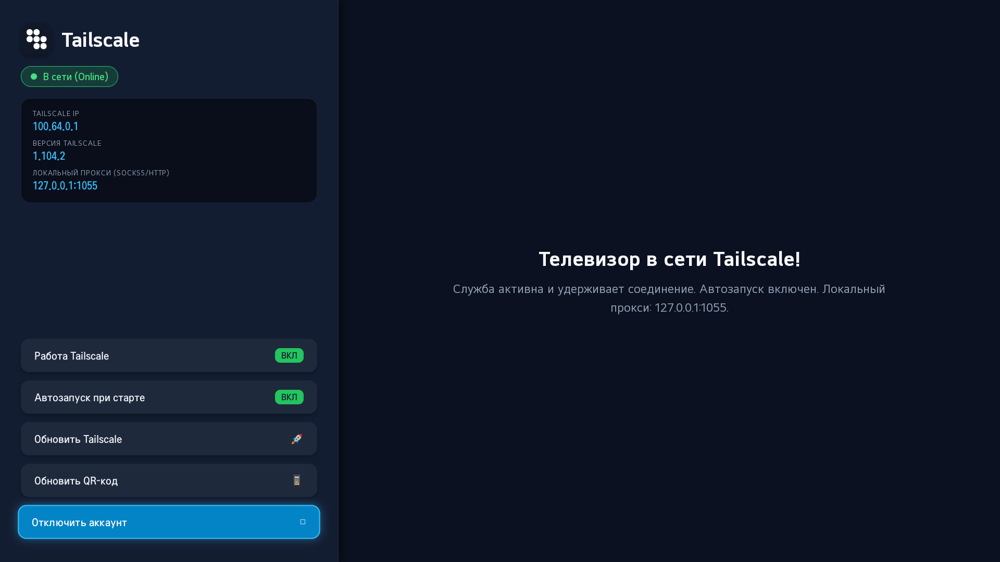

# Tailscale for LG webOS TV

[](https://github.com/neon1301/tailscale-webos/actions/workflows/build.yml)
[](LICENSE)
[](#)
[-orange.svg)](#)

Клиент **Tailscale** для телевизоров **LG webOS** с графическим интерфейсом для пульта ДУ, авторизацией по QR-коду, автозапуском в фоне 24/7 и встроенным онлайн-обновлением.

> **Важно:** Для работы **НЕ ТРЕБУЕТСЯ ROOT**! Tailscale работает в режиме `userspace-networking` и предоставляет локальный защищённый SOCKS5/HTTP-прокси (`127.0.0.1:1055`) для приложений (Lampa, TorrServe, OTT-плееры и др.).

<p align="center">
  
</p>

---

## 🌟 Основные возможности

* 🚀 **Без Root-прав:** Работает в стандартном режиме разработчика (Developer Mode) или с Root.
* 📱 **Авторизация по QR-коду:** Большой QR-код прямо на экране ТВ — наведите камеру смартфона для мгновенного входа.
* 🎮 **Удобное управление пультом ДУ:** Полная навигация стрелками пульта и кнопкой OK.
* ⚡ **Автозапуск и Watchdog 24/7:** Фоновая служба сама стартует при включении телевизора и автоматически переподключается при сбоях сети или Wi-Fi.
* 🔘 **Выключатель питания:** Быстрое включение/отключение Tailscale в один клик с пульта.
* 🔄 **Встроенное автообновление:** Проверка и установка свежих официальных версий Tailscale прямо с сервера `pkgs.tailscale.com` без ПК!
* 🌐 **Локальный SOCKS5/HTTP прокси:** Сервер `127.0.0.1:1055` для перенаправления трафика любых ТВ-приложений через ваш Tailnet / Exit Node.

---

## 📦 Быстрая установка

1. Скачайте свежий `.ipk` файл со страницы [Releases](https://github.com/neon1301/tailscale-webos/releases/latest) (актуальный релиз: [`com.tailscale.webos_1.104.8_all.ipk`](https://github.com/neon1301/tailscale-webos/releases/download/v1.104.8/com.tailscale.webos_1.104.8_all.ipk)).
2. Установите на телевизор через **webOS Dev Manager** (просто перетащите файл мышкой) или через SSH:
   ```bash
   luna-send-pub -n 1 'luna://com.webos.appInstallService/dev/install' '{"id":"com.tailscale.webos","ipkUrl":"/tmp/tailscale.ipk"}'
   ```
3. Откройте приложение **Tailscale** в меню телевизора.
4. Отсканируйте камерой смартфона QR-код на экране ТВ и нажмите **«Connect»**.
5. Экран телевизора покажет зелёный статус **«В сети (Online)»** и ваш постоянный Tailscale IP (`100.x.y.z`).

---

## 📺 Настройка кинотеатров (Lampa, TorrServe, Vimu и др.)

Tailscale на webOS слушает локальный порт:
* **IP-адрес:** `127.0.0.1`
* **Порт:** `1055`
* **Протоколы:** `SOCKS5` и `HTTP`

В настройках любого приложения (например, **Lampa** ➔ *Настройки* ➔ *Сеть/Прокси*):
* Включить прокси: `Да`
* Тип: `SOCKS5` (или `HTTP`)
* Сервер: `127.0.0.1`
* Порт: `1055`

Теперь трафик приложения безопасно идёт через ваш домашний сервер, VPS или выбранный Exit Node в Tailscale!

---

## 🎮 Настройка игр: Moonlight / Sunshine / DuoStream

Для удаленного гейминга с дачи или из другой сети на домашний игровой ПК (`100.x.y.z`):

1. **Вариант с Root (Рекомендуется для 4K 60/120FPS с минимальной задержкой):**
   * При наличии Root-прав Tailscale автоматически запускается с драйвером ядра `/dev/net/tun` (`tailscale0`).
   * Телевизор становится полноправным узлом сети: в **Moonlight на ТВ** вы просто вводите Tailscale IP вашего ПК (например, `100.66.187.32`) напрямую и играете без лагов и задержек.
2. **Вариант без Root (через дачный роутер Subnet Router):**
   * Если ТВ без Root, включите на роутере с Tailscale (Keenetic, OpenWrt, Mikrotik) или любом ПК на даче функцию **Subnet Router**:
     ```bash
     tailscale up --advertise-routes=192.168.1.0/24 --accept-routes
     ```
   * Телевизор по обычной локальной сети сможет обращаться к IP вашего домашнего ПК без модификаций Moonlight.

---

## ⚡ Архитектура Dual-Channel (Сверхбыстрый отклик интерфейса)

Приложение использует двухканальную модель передачи данных:
* **Канал 1 (Высокоскоростной HTTP API `127.0.0.1:1056`):** Мгновенная передача статуса, IP-адресов и команд переключения питания/автозапуска за 0–3 мс.
* **Канал 2 (Системная шина webOS Luna):** Резервный канал для взаимодействия с системными сервисами webOS и фоновым запуском при старте ТВ.

---

## 🛠 Сборка из исходников

Для сборки требуется только **Python 3**:

```bash
git clone https://github.com/neon1301/tailscale-webos.git
cd tailscale-webos

# Запуск скрипта сборки
python package_tailscale.py
```

Скрипт автоматически:
1. Загрузит свежие официальные статические ARM-бинарники Tailscale с `pkgs.tailscale.com`.
2. Соберёт стандартный Debian AR `.ipk` архив со всеми разрешениями и службами.
3. Готовый файл появится в корневой папке: `com.tailscale.webos_*.ipk`.

---

## ⚙️ Структура репозитория

```
tailscale-webos/
├── .github/workflows/build.yml # Автосборка IPK на GitHub Actions
├── tailscale_build/
│   ├── app/                    # Web-интерфейс для TV (HTML5, QR, remote navigation)
│   ├── service/                # Фоновая Node.js служба webOS (Luna bus, watchdog)
│   └── pkg/                    # Метаданные пакета webOS
├── package_tailscale.py        # Скрипт сборки IPK
├── build.bat                   # 1-клик сборка для Windows
├── build.sh                    # Сборка для Linux/macOS
├── LICENSE                     # BSD-3-Clause
└── README.md
```

---

<details>
<summary><b>English Version</b></summary>

### Features
* **No Root Required:** Operates in `userspace-networking` mode, providing SOCKS5/HTTP proxy at `127.0.0.1:1055`.
* **Zero-latency Dual-Channel Architecture:** Direct HTTP API (`127.0.0.1:1056`) guarantees 0-3ms UI telemetry + Luna bus fallback.
* **Gaming Setup (Moonlight / Sunshine / DuoStream):** Direct connection supported with root (`tailscale0` kernel tun), or via Subnet Router on LAN.
* **QR Code Login:** Large QR code on TV screen for instant smartphone pairing.
* **Remote Control Friendly:** Optimized for LG TV Magic Remote / D-pad with instant optimistic feedback.
* **24/7 Watchdog:** Self-healing background service that restarts on network changes or boot.
* **In-app Self-Update:** Download and apply latest Tailscale official ARM releases without a PC.

### Installation
Download the latest [com.tailscale.webos_1.104.8_all.ipk](https://github.com/neon1301/tailscale-webos/releases/download/v1.104.8/com.tailscale.webos_1.104.8_all.ipk) from [Releases](https://github.com/neon1301/tailscale-webos/releases/latest) and install via webOS Dev Manager.

</details>

---

## 📄 Лицензия

Этот проект распространяется под лицензией [BSD-3-Clause](LICENSE), аналогично официальному клиенту Tailscale.
